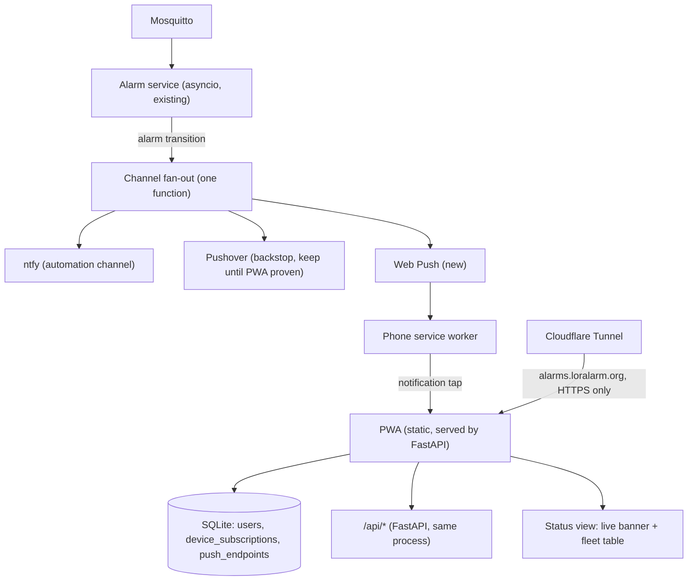

# LoRaLarm PWA — notification + status app (design brief)

Companion to the migration spec (`loralarm-migration-spec`). Working document for
implementing the PWA in VS Code with Mistral Vibe. The alarm service already fans out
alarm transitions to channels (ntfy, Pushover); this app becomes a **third channel**
plus the end-user frontend. Nothing in the alarm logic changes.

## 1. Goal

A PWA (installable web app) where each user selects which devices they want alarms
from, and receives native push notifications (Web Push / VAPID) on their phone. It also
shows the live fleet status (same data as the status page). Replaces ntfy/Pushover for
day-to-day use over time; Pushover stays as backstop until proven reliable.

**Non-goals:** user-configurable thresholds (device config stays in the service config
file), dashboards/history (Grafana stays), admin UI (ChirpStack stays).

## 2. Architecture



- **One process:** PWA + API + Web Push all live in the existing Python service
  (FastAPI already planned for the status page). One container, one config.
- **Public path via Cloudflare Tunnel** (loralarm.org is already on Cloudflare Pages):
  `alarms.loralarm.org` → tunnel to blue-104. No open ports, TLS free. Service workers
  and push **require HTTPS**.
- **Data flows once:** alarm state machine is unchanged; the fan-out function gains a
  `webpush` branch that queries subscriptions and pushes per device.

## 3. UX / subscription model

- **Users subscribe by device list, never by typing EUIs.** The app shows the fleet
  (from the ChirpStack registry cache: name, kind, battery, last-seen) with toggles.
  devEUI is the join key under the hood.
- **Per-device arm/disarm (larm på/av):** every device has an `armed` state, global
  (not per-user). Off = alarm evaluation skipped for that device, no notifications on
  any channel (use case: service/bench work, vacation on a noisy sensor). Shown as a
  🛡 chip on cards, full toggle on device detail. Persisted in the service state table
  and exposed via `GET/PUT /api/devices/{eui}/armed`; changes are audited (who/when)
  in the events table. Distinguish from the follow-toggle, which is per-user and only
  gates that user's notifications.
- Notification permission prompt only after the user has picked devices
  (don't scare people with the prompt on first load).
- Minimal account model: invite-link or PIN per user (issued in service config, no
  password infrastructure), session cookie, per-user device selection + push endpoints.
  Swedish UI.
- Notification tap deep-links to the device's status view.
- Status view: alarm banner (from service in-RAM state) + fleet table
  (last-seen, battery, alarm state). No charts; deep-link to Grafana for history.

## 4. Data model (SQLite, same DB as the events table)

```sql
users            (id, name, pin, created_at)
device_subs      (user_id, dev_eui)                     -- which devices a user follows
push_endpoints   (user_id, endpoint, p256dh, auth, ua, created_at)  -- Web Push subscription
```

Events table unchanged; a delivery log (`webpush_log`: transition_id, endpoint, ok)
helps debug failed endpoints.

## 5. Backend pieces

- **FastAPI routes** (same app as status page):
  - `GET /api/devices` — fleet from registry cache + last alarm state
  - `GET/PUT /api/subscriptions` — the user's device set
  - `POST /api/push/subscribe`, `DELETE ...` — Web Push subscription register/remove
  - `GET /api/state` or SSE — live banner polling (15–30 s auto-refresh)
  - static: `manifest.webmanifest`, `sw.js`, icons, the app itself
- **Web Push:** `pywebpush`, VAPID keypair (generate once, store in service config,
  gitignore the private key). On alarm transition: for each device, look up subscribed
  users → endpoints → send. Prune endpoints on 410/404.
- **Fan-out change:** the notification function currently does ntfy + Pushover in one
  call; extend with webpush behind a config flag `channels: [ntfy, pushover, webpush]`.
- **Auth:** PIN in config → login route sets signed session cookie (itsdangerous or
  similar; no user DB writes needed beyond the row above).

## 6. Frontend pieces (PWA)

- Static HTML/JS (no framework needed; the status page already goes HTMX/plain-fetch).
  `manifest.webmanifest`: name, icons (192/512), display: standalone, theme color.
- **`sw.js`:** `push` event handler → `showNotification(title, {data: dev_eui})`;
  `notificationclick` → focus/open the app at the device view.
- Subscribe flow: `Notification.requestPermission()` → `pushManager.subscribe(...)` →
  POST endpoint + keys to `/api/push/subscribe`.
- iOS requirement: PWA must be **installed to home screen** before push permission is
  available (iOS 16.4+). Show an in-app install hint for iOS users.
- Keep it small: two views (fleet/status, device detail), one settings view (device
  toggles + push state).

## 7. Delivery reliability (why Pushover stays for now)

| | ntfy | Pushover | Web Push in PWA |
|---|---|---|---|
| Android | app/PWA | great | works without install |
| iOS | app | great (APNs) | needs home-screen install; less battle-tested |
| Cost | done | done (one-time ~$5) | build + VAPID + tunnel |

Plan: run all three channels in parallel; compare delivery over a month of real
alarms; then decide per-channel retirement. Retiring a channel = removing it from
`channels` in config, nothing else.

## 8. Shortcut alternative (evaluate before building)

Self-hosted ntfy already ships a PWA with web push and per-topic subscriptions.
Publishing one topic per device (already the pattern) gives device-following UX for
free. Trade-offs: generic UI, iOS web-push limits identical, self-hosted web push
relays through ntfy.sh's gateway by default, no deep-link into our status page.
Decision: build the custom PWA for UX and control; keep ntfy for automation.

## 9. Implementation order

1. Cloudflare Tunnel to the service on blue-104, HTTPS live.
2. FastAPI static serving + `/api/devices` (registry cache) + PIN auth.
3. Web Push: VAPID keys, `/api/push/subscribe`, fan-out branch, `sw.js` handler.
4. Subscription UI: fleet list with toggles; per-user device_subs.
5. Status views: banner + fleet table (status-page spec §9 applies to both surfaces).
6. Delivery log + 1 month parallel comparison with Pushover; then channel decision.

## 10. Security notes

- Service must never be exposed raw: only via the tunnel with HTTPS; Mosquitto stays
  LAN-only; no inbound ports on the router.
- Push endpoints are secrets (anyone with them can push): store only, never log.
- VAPID private key in service config, not in git.
- Rate-limit the login route (PIN brute force) — simple per-IP delay is enough at this
  scale.
