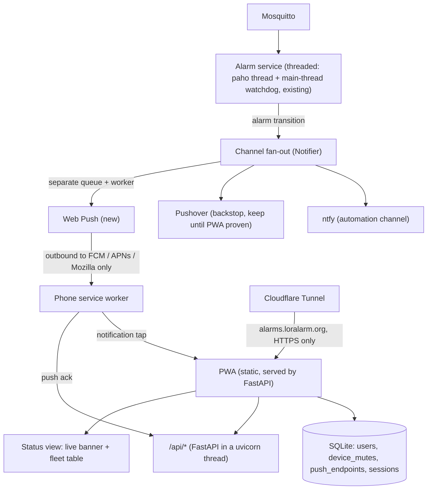

# LoRaLarm PWA — notification + status app (design brief)

Companion to the migration spec (`loralarm-migration-spec`). Working document for
implementing the PWA in VS Code with Mistral Vibe. The alarm service already fans out
alarm transitions to channels (ntfy, Pushover); this app becomes a **third channel**
plus the end-user frontend. The alarm *evaluation* logic does not change; the engine
gains a small number of hooks (see §5.1).

Reviewed against `server/python/loralarm/` (see §11 for the review log).

## 1. Goal

A PWA (installable web app) where each user selects which devices they want alarms
from, and receives native push notifications (Web Push / VAPID) on their phone. It also
shows the live fleet status (same data as the status page). Replaces ntfy/Pushover for
day-to-day use over time; Pushover stays as backstop until proven reliable.

**Non-goals:** user-configurable thresholds (device config stays in the service config
file), dashboards/history **including charts** (Grafana stays; the device view only
deep-links to it), admin UI (ChirpStack stays).

## 2. Architecture



- **Threaded, not asyncio.** The existing service is threaded: `Engine.on_uplink` runs on
  the paho thread, `watchdog_tick` on the main thread, both under one `threading.Lock`;
  `Notifier` is stdlib-only with one worker thread. FastAPI therefore runs in a uvicorn
  **thread** and reads engine state through a lock-protected snapshot method
  (`Engine.snapshot()`), never by touching `Engine.devices` directly.
- **New dependencies** (today: `paho-mqtt` only): `fastapi`, `uvicorn`, `pywebpush`
  (blocking, pulls in `requests`/`cryptography`), `itsdangerous` or equivalent.
  Keep them optional (`requirements-web.txt`) so replay/tests/alarm-only deployments
  stay dependency-light.
- **Process isolation (decision needed, see §12).** One process is simplest, but a crash,
  memory blow-up or request flood in the public API would also stop alarm evaluation and
  the watchdog. Default recommendation: start in-process **with** hard limits (request
  size, per-user rate limit, no unbounded queries, API thread exceptions never propagate),
  and keep the web layer behind a narrow interface (`Engine.snapshot()`, `armed` store,
  `EventLog`) so it can be split into a second container sharing the SQLite file (WAL)
  without redesign.
- **Public path via Cloudflare Tunnel** (loralarm.org is already on Cloudflare Pages):
  `alarms.loralarm.org` → tunnel to blue-104. No open ports, TLS free. Service workers
  and push **require HTTPS**. Consider Cloudflare Access in front as a second layer;
  note that Cloudflare terminates TLS and can see fleet/alarm data (accept explicitly).
- **Alarms must not depend on the tunnel.** Web Push sending only needs *outbound*
  access to the push services. Tunnel down = no UI, **not** no alarms.
- **Data flows once:** the alarm state machine is unchanged; the fan-out gains a
  `webpush` branch (own queue/worker, §5.1) that queries subscriptions and pushes per
  device.

## 3. UX / subscription model

- **Users subscribe by device list, never by typing EUIs.** The app shows the fleet
  with toggles. devEUI is the join key under the hood. Fleet source: the ChirpStack
  registry cache **once it exists** (spec §7.2, README next-step #1 — still open);
  until then the fallback is config devices + `device_state` rows (`EventLog.known_devices()`).
- **Default follow state:** a new user follows **all** devices (opt out, not opt in),
  so a new device never alarms to nobody silently. Devices with zero followers show a
  warning in the app and a log line in the service.
- **Per-device arm/disarm (larm på/av):** every device has an `armed` state, global
  (not per-user). Off = **no notifications on any channel** (use case: service/bench
  work, vacation on a noisy sensor). Shown as a 🛡 chip on cards, full toggle on device
  detail. Exposed via `GET/PUT /api/devices/{eui}/armed`. Distinguish from the
  follow-toggle, which is per-user and only gates that user's push notifications.
  Rules (this is the riskiest feature; it can silence frost/break-in alarms for everyone):
  - **Mechanism:** the engine keeps evaluating and logging transitions while disarmed;
    only notification fan-out is suppressed in `Engine._emit`. State and fire-once
    bookkeeping stay correct, no stale baseline on re-arm. Disarmed transitions are
    logged with `kind` as usual plus a `suppressed` marker in `detail`.
  - **Snooze, not permanent off:** disarm carries an expiry (preset 1 h / 8 h / 24 h /
    "tills vidare" only for admins). Auto re-arm at expiry.
  - **On re-arm** with a condition still active: send a fresh notification.
  - **Watchdog** (`stale`) is still tracked while disarmed (shown in the UI, not notified).
  - **Everyone is told:** a push to all followers on disarm and on re-arm.
  - **Roles:** `can_disarm`/`admin` flag per user in config; others see the state only.
  - **Persistence:** SQLite (`device_armed`), **not** `devices.json` — config hot-reload
    must never reset or override it. Audit (who/when/expiry) in the events table:
    `kind="armed"`, user in `detail`, or add a `user` column.
  - Disarm needs a confirmation step in the UI.
- Notification permission prompt only after the user has picked devices
  (don't scare people with the prompt on first load).
- Minimal account model: invite-link per user (§5 Auth), session cookie, per-user device
  selection + push endpoints. Swedish UI.
- Notification tap deep-links to the device's status view; if the session has expired,
  redirect to login and keep the target.
- Status view: alarm banner (from service in-RAM state) + fleet table
  (last-seen, battery, alarm state). **No charts**; deep-link to Grafana for history.
  Stale ("ingen kontakt") counts as an active alarm and sorts with the problems.

## 4. Data model (SQLite, same DB as the events table)

```sql
users            (id, name, token_hash, role, created_at, disabled)   -- invite token stored hashed
sessions         (id, user_id, created_at, expires_at, revoked)       -- server-side, revocable
device_mutes     (user_id, dev_eui)                                   -- devices a user muted (opt-out: default = follow all)
push_endpoints   (id, user_id, endpoint UNIQUE, p256dh, auth, ua, created_at,
                  last_success, fail_count)                           -- Web Push subscription
device_armed     (dev_eui PRIMARY KEY, armed, until, changed_by, changed_at)
webpush_log      (event_id, endpoint_id, status, http_code, ts)       -- endpoint_id, never the raw endpoint
push_ack         (event_id, endpoint_id, ts)                          -- written by the service worker ack
```

- `EventLog` owns the single SQLite connection and lock; new tables go through that
  class (or share its lock). Enable WAL if the web side ever gets its own connection.
- Last reading per device (temp, battery V/%, RSSI/SNR, fCnt) is **not** kept by the
  engine today (`AlarmState` holds only `active`, `last_seen`, accel baseline). Add a
  small `last_reading` to `AlarmState`/`snapshot()` so the device view works without
  Influx. Fields the engine doesn't track are not shown.

## 5. Backend pieces

- **FastAPI routes** (same app as status page):
  - `GET /api/devices` — fleet (see §3 for the source) + last alarm state/reading
  - `GET/PUT /api/subscriptions` — the user's device set
  - `GET/PUT /api/devices/{eui}/armed` — arm state; PUT takes `armed` + `snooze` duration
  - `POST /api/push/subscribe`, `DELETE ...` — Web Push subscription register/remove
  - `POST /api/push/ack` — service-worker delivery receipt (§7)
  - `GET /api/state` — live banner, **plain polling** every 15–30 s. SSE is dropped:
    proxy buffering/idle timeouts through the tunnel make it unreliable.
  - static: `manifest.webmanifest`, `sw.js`, icons, the app itself
- **Web Push:** `pywebpush`, VAPID keypair (generate once, store in service config,
  gitignore the private key). On alarm transition: for each device, look up subscribed
  users → endpoints → send. Prune endpoints on 404/410; back off and retry on 429/5xx;
  track `fail_count`/`last_success` and drop endpoints that fail persistently.
- **Payload spec** (JSON, same Swedish text as `notify.message_text`):
  `{title, body, dev_eui, kind, active, event_id}`. Headers: `Urgency: high` for fire
  (Android Doze), lower for clear; a `TTL` of ~1 h (a fire push arriving 12 h later is
  noise); service worker `tag = dev_eui:kind` so a clear replaces its fire notification.
- **Fan-out change:** `Notifier._deliver` currently does ntfy then Pushover sequentially
  on one worker with retry backoff of 1/5/30 s per channel. Web Push **must not** share
  that worker: N slow endpoints would delay later ntfy/Pushover alarms. Give it its own
  queue + worker thread; enabled via config `channels: [ntfy, pushover, webpush]`.
- **Auth:** long random **invite token** (≥128 bit, stored hashed) is exchanged once for
  a **server-side session** (`sessions` table: revocable, expiring), set as
  `HttpOnly; Secure; SameSite=Lax` cookie. Every request resolves the session → user
  (disabled user = logged out immediately). Users are seeded from config (token + role)
  into SQLite; config is the single source of truth for who may exist. If short PINs are
  kept for convenience: per-user lockout after N failures, not per-IP.
  CSRF: all state-changing routes (esp. `PUT armed`) require a custom header/CSRF token
  and verify `Origin`.

### 5.1 Engine / Notifier changes required

Small, but not zero — the design is not "nothing changes":

1. `Engine._emit`: log the event **first** so its id exists, then call
   `notifier.notify(..., event_id)` (needed by `webpush_log`/`push_ack`). Skip fan-out
   when the device is disarmed (§3).
2. `Engine`: `armed` lookup (cached from SQLite, invalidated on PUT), snooze expiry
   check in the watchdog tick, re-arm notification.
3. `Engine.snapshot()`: lock-protected copy of devices/state/last reading for the API.
4. `AlarmState`: add `last_reading` and include it in `snapshot()`/`restore()`.
5. `Notifier`: webpush queue/worker, `channels` config, per-channel delivery logging.
6. `EventLog`: new tables, WAL, shared lock; optional `user` column.
7. Pushover: today only priority 1 is sent; critical kinds need priority 2 (§7).

## 6. Frontend pieces (PWA)

- Static HTML/JS (no framework needed; the status page already goes HTMX/plain-fetch).
  `manifest.webmanifest`: name, icons (192/512), display: standalone, theme color.
- **`sw.js`:** `push` event handler → **always** `showNotification(...)` (iOS revokes the
  subscription if a push shows nothing) with `tag`, `data: {dev_eui, event_id}`; also
  `fetch('/api/push/ack?id=…')` so delivery is measurable; `notificationclick` →
  focus/open the app at the device view (login redirect keeps the target).
- **Logout** deletes this device's push endpoint, so a second user on a shared phone
  does not inherit the first user's alarms.
- Subscribe flow: `Notification.requestPermission()` → `pushManager.subscribe(...)` →
  POST endpoint + keys to `/api/push/subscribe`.
- iOS requirement: PWA must be **installed to home screen** before push permission is
  available (iOS 16.4+). Show an in-app install hint for iOS users.
- Keep it small: two views (fleet/status, device detail), one settings view (device
  toggles + push state).

## 7. Delivery reliability (why Pushover stays for now)

| | ntfy | Pushover | Web Push in PWA |
|---|---|---|---|
| Android | app/PWA | great | works without install |
| iOS | app | great (APNs) | needs home-screen install; less battle-tested |
| Cost | done | done (one-time ~$5) | build + VAPID + tunnel |

Web Push cannot match Pushover for critical alarms: no emergency priority, no
retry-until-acknowledged, and it respects iOS Focus / Do Not Disturb.

Plan: run all three channels in parallel; compare delivery over a month of real
alarms; then decide per-channel retirement. **Metric:** a push-service 201 does not mean
the phone got it — count `push_ack` rows per `event_id` vs. sent. Retiring a channel =
removing it from `channels` in config, nothing else — **except** that Pushover
(priority 2) stays for critical kinds (temp/frost, motion/tilt, circuit) indefinitely;
only ntfy and non-critical kinds are candidates for retirement.

## 8. Shortcut alternative (evaluate before building)

Self-hosted ntfy already ships a PWA with web push and per-topic subscriptions.
Publishing one topic per device (already the pattern) gives device-following UX for
free. Trade-offs: generic UI, iOS web-push limits identical, self-hosted web push
relays through ntfy.sh's gateway by default, no deep-link into our status page.
Decision: build the custom PWA for UX and control; keep ntfy for automation.

## 9. Implementation order

0. Prerequisites: engine hooks from §5.1 (event-id-first `_emit`, `Engine.snapshot()`,
   `last_reading`, separate webpush worker skeleton); fleet source decided (§3).
1. Cloudflare Tunnel to the service on blue-104, HTTPS live (optionally Access).
2. FastAPI static serving + `/api/devices` + invite-token auth + sessions + CSRF.
3. Web Push: VAPID keys, `/api/push/subscribe`, fan-out branch, `sw.js` handler, ack.
4. Subscription UI: fleet list with toggles; per-user device_mutes (opt-out, so default = follow all).
5. Arm/disarm with snooze, roles, audit, notifications to followers.
6. Status views: banner + fleet table (status-page spec §9 applies to both surfaces).
7. Delivery log + ack metric + 1 month parallel comparison with Pushover; then decision.

## 10. Security notes

- Service must never be exposed raw: only via the tunnel with HTTPS; Mosquitto stays
  LAN-only; no inbound ports on the router.
- Push endpoints are secrets (anyone with them can push): store only, never log;
  `webpush_log` references `endpoint_id`, not the endpoint URL.
- VAPID private key in service config, not in git.
- Login: high-entropy invite tokens stored hashed; revocable server-side sessions;
  per-user lockout. Behind the tunnel the peer IP is Cloudflare's, so any per-IP
  limiting must use `CF-Connecting-IP`, trusted only from the tunnel.
- CSRF protection + `Origin` check on all state-changing routes.
- Disarm is a privileged, audited, time-limited action (§3).
- API hardening: request size limits, bounded queries, rate limits; API-thread failures
  must never affect the alarm path.

## 11. Review log (2026-11-11)

Findings from reviewing this brief and the mockup against the code, now folded into
the sections above: service is threaded not asyncio (§2); webpush needs its own worker
(§5); registry cache does not exist yet (§3); engine has no last-reading storage (§4);
`armed` needs mechanism/snooze/roles/persistence (§3); `_emit` logs the event after
notifying, so no event id for the delivery log (§5.1); PIN/cookie auth weaknesses (§5,
§10); SSE dropped (§5); delivery metric via ack (§7); Pushover priority 2 stays for
critical kinds (§7); mockup inconsistencies fixed (see mockup).

## 12. Open decisions

- One process vs. separate web container (§2) — default: in-process with limits, keep
  the seam clean.
- Fleet source until the ChirpStack registry cache lands (§3).
- Roles: which users may disarm / "tills vidare".
- Cloudflare Access in front of the tunnel: yes/no.
- Whether the `events` table gets a `user` column or the audit lives in `detail`.
