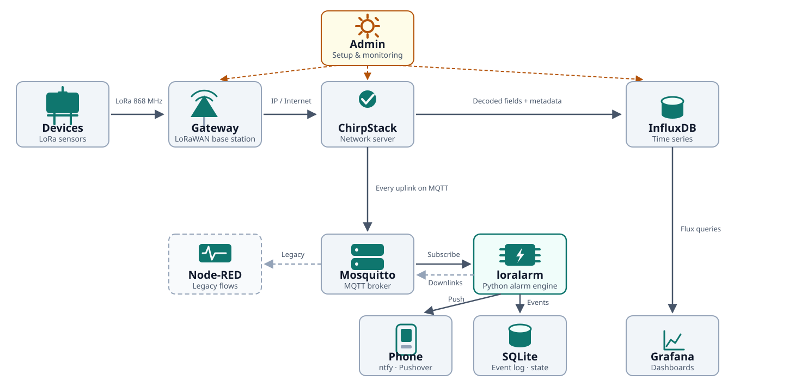

# loralarm.org

**An open, battery-powered LoRaWAN alarm and sensor system** — from firmware on the sensor nodes to the gateways, network server and notification service, collected in one repository. Published at [loralarm.org](https://loralarm.org).

## What is LoRaLarm?

LoRaLarm is a DIY alarm and monitoring system built on LoRaWAN sensors (RAK WisBlock hardware) that report switch state, motion, temperature, battery voltage and more over the air. Uplinks travel through a LoRa gateway to ChirpStack, where a rule-driven service evaluates every frame and pushes notifications (ntfy, Pushover) when something happens — a door opens, motion is detected, a battery runs low, a device goes silent. Everything is open source under the MIT license.

Highlights:

- **Battery-first firmware** — LoRaWAN OTAA, deep sleep between events (~24 µA idle on RAK3172), immediate uplink on switch change or motion, periodic heartbeats, AT-command configuration and downlink support
- **Modular hardware** — RAK3172 (STM32WLE5) and RAK4631 (nRF52840) core modules with pluggable WisBlock sensors (temperature/humidity, pressure, light, accelerometer, BME680) and a switch/alarm input
- **Data-driven server core** — device families, alarm rules and field transforms are defined in JSON, not hardcoded; adding a sensor type means one file
- **Rule-based alarms** — temperature, battery, motion and circuit rules plus watchdog monitoring of silent devices, with per-device/family/default configuration layers
- **Notification fan-out** — ntfy and Pushover delivery with retries, alarm time windows, per-device settings
- **Event history** — every uplink and alarm transition is logged to SQLite with per-device state snapshots
- **Downlink control** — tune accelerometer sensitivity, send intervals and device settings over the air

## Structure

| Directory | Contents |
|---|---|
| [`site/`](site/) | Source for the [loralarm.org](https://loralarm.org) website — Hugo, auto-published on Cloudflare Pages (see [`site/README.md`](site/README.md)) |
| [`devices/`](devices/) | LoRa client firmware: [`rui3_sensor/`](devices/rui3_sensor/) (RAK3172/RAK4631 sensor firmware, Cayenne LPP) and [`android_rak4631/`](devices/android_rak4631/) (Arduino-based alarm node) |
| [`server/`](server/) | Server side: [`chirpstack/`](server/chirpstack/) (payload codecs, fixtures, migration spec), [`node-red/`](server/node-red/) (the original flow-based glue), [`python/`](server/python/) (the current `loralarm` service — ingest, alarm engine, notifications, downlinks) |
| [`PWA/`](PWA/) | Design brief and mockups for the planned installable notification + fleet-status web app |
| [`docs/`](docs/) | Project-wide diagrams and documentation |

## Data flow

1. **Devices** (battery-powered RAK nodes) send uplinks — heartbeats and event-triggered frames — over 868 MHz LoRaWAN.
2. A **gateway** forwards them to **ChirpStack**, where the per-family payload codec decodes the frame into an `object`.
3. ChirpStack publishes every uplink on MQTT; the **loralarm service** (and the original Node-RED flows) consume the feed, evaluate alarm rules against per-device configuration and persist state to SQLite.
4. Alarm transitions fan out as **push notifications** (ntfy / Pushover) and update the web dashboard.

See [`server/python/ARCHITECTURE.md`](server/python/ARCHITECTURE.md) for the design of the service and [`server/chirpstack/loralarm-node-red-→-chirpstack-+-influxdb-+-python-migration-spec.md`](server/chirpstack/loralarm-node-red-%E2%86%92-chirpstack-+-influxdb-+-python-migration-spec.md) for the migration story behind it.

### Tech stack

- **Firmware:** RAK RUI3 / Arduino (STM32WLE5, nRF52840), Cayenne LPP payloads
- **Network server:** ChirpStack with JavaScript payload codecs, Mosquitto MQTT
- **Service:** Python (stdlib-only core, paho-mqtt, SQLite), rule engine driven by JSON device-family definitions
- **Glue (legacy/parallel):** Node-RED flows
- **Website:** Hugo on Cloudflare Pages
- **Observability:** InfluxDB + Grafana (planned PWA for end-user status)

## Getting started

- **Edit the website:** run `hugo server` in `site/` — see [`site/README.md`](site/README.md) for the workflow and Cloudflare Pages build settings. Every `git push` publishes automatically.
- **Build device firmware:** see [`devices/rui3_sensor/README.md`](devices/rui3_sensor/README.md) for supported hardware, wiring notes and AT commands.
- **Run the service:** see [`server/python/README.md`](server/python/README.md) — `python3 -m loralarm` subscribes to the ChirpStack MQTT feed; tests run with `python3 -m unittest discover -s tests -t .` (stdlib only).

## License

[MIT](LICENSE) © Tomas · SM0ONR
