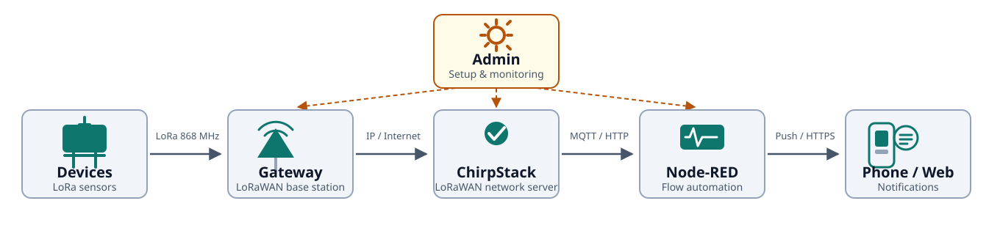

# loralarm.org

Home of the entire LoRaLarm project: website, device and server code collected in the same repository.

## Structure

- `site/` – source code for the website [loralarm.org](https://loralarm.org), built with Hugo and published on Cloudflare Pages (see `site/README.md`)
- `devices/` – code for LoRa clients/sensors (firmware, hardware design)
- `server/` – code for base units/gateways and the network server

The website is rebuilt automatically on Cloudflare Pages on every `git push` – see `site/README.md` for the editing workflow and build settings.

## Data flow

