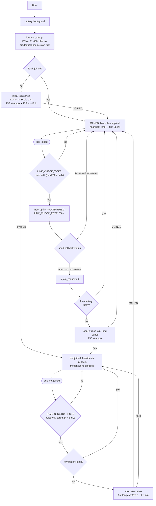

# rui3_sensor2 — modular LoRaLarm RUI3 firmware

Second-generation RUI3 firmware for **RAK3172** (STM32WLE5) and **RAK4631-R** (nRF52840) with
WisBlock sensors RAK1901/1902/1903/1904/1906 and a switch input. It is a **drop-in replacement for
[`../rui3_sensor`](../rui3_sensor)** (v33): same LoRaWAN behaviour, same Cayenne LPP channel map, same
AT commands, same downlinks, so the server and codecs need no change. The old firmware stays as the
reference until this one has run in the field.

What changed is the structure: the 1,100-line `.ino` is split into modules with one job each, the
decision logic is pure and unit-tested on the host, and adding a sensor is one table row.

For the payload channel table, hardware list, battery-sensing modes, power notes and AT commands see
the [`rui3_sensor` README](../rui3_sensor/README.md); everything there still applies.

ToFo: A list with needed AT-commnds, such as ATC+SENDINT=300, devEUI, joinEUI, appKey, etc.

## Module map

| File | Responsibility |
|---|---|
| `rui3_sensor2.ino` | `setup()` sequencing and `loop()` — nothing else |
| `config.h` | Compile-time settings: logging, pins, join/battery policy, timing, LPP channel map, `FW_VERSION_BYTE` |
| `state.h` / `state.cpp` | All cross-module runtime state in one place, with which context may touch it |
| `sensors.h` / `sensors.cpp` | **Sensor registry** — one table drives init, wake-up, read, shutdown, alert reads and conflicts |
| `RAK1901…1906_*.cpp` | Sensor drivers (unchanged apart from the registry hooks) |
| `battery.h` / `battery.cpp` | Boot guard, confirmed-critical check, shutdown latch, per-tick supervision |
| `uplink.h` / `uplink.cpp` | Heartbeat (`sensor_handler`), packet send, send timer |
| `lorawan.h` / `lorawan.cpp` | Join policy, callbacks, downlink handling, P2P callbacks |
| `custom_at.cpp` | Flash settings and the custom AT commands (`SENDINT`, `MININT`, `BATCRIT`, `BATMODE`, `STATUS`) |
| `switch_gpio.cpp` | Debounced switch input |
| `platform*.{h,cpp}` | MCU differences (battery ADC, BLE, power rail) — no `#ifdef` for the MCU elsewhere |
| `battery_policy.h`, `send_policy.h`, `downlink_parse.h` | **Pure** decision rules, no Arduino includes, host-tested |

### Adding a sensor
1. Write `init_x / read_x / startup_x / shutdown_x` in its own `.cpp` and declare them in `sensors.h`.
2. Add a `SensorId` and one row in the table in `sensors.cpp`. Set `suppressed_by` if it writes the
   same LPP channels as another sensor (as the RAK1906 does for RAK1901/1902) and `read_alert` if it
   can give a quick temperature/humidity reading for a motion frame (otherwise `nullptr`).
3. Add its I2C address to `i2c_known[]` (diagnostics) and, if it has a new measurement, a channel in `config.h`.

No change is needed in `sensor_handler`, `setup()` or the alert path.

## Behaviour notes (differences from v33)

- **Version byte is 100** (`FW_VERSION_BYTE`), so a node on this line is distinguishable on ch 7.
- **Downlink range check fixed.** v33 computed the 3-digit value in a `uint8_t`, so `300` wrapped to
  `44` and was accepted on port 5. It is now validated as a real number and rejected.
- Motion alerts carry live X/Y/Z and temp/humidity: from the RAK1901 if present, otherwise from the
  RAK1906 via a quick heater-off reading (`read_rak1906_fast`, ch 2/3 only — no pressure or gas, to
  keep the alert fast). v33 only did this for the RAK1901. `heartbeat_busy` still defers an alert
  that fires mid-heartbeat.
- Everything else — join/ADR/TXP handling, battery latch and hysteresis, boot guard, caching of the
  session, BLE re-arm on nRF52 — is a straight port.

## Connection supervision

Radio settings are fixed after every join: +16 dBm (TXP 0), ADR off, DR3 (`POST_JOIN_*` in `config.h`;
`lorawan_enforce_link_policy()` restores them before each uplink if anything changed them). Two jobs run
on one periodic tick (`RAK_TIMER_4`, `REJOIN_CHECK_INTERVAL_MS`; production 1 h, test 1 min):



| Scenario | What happens |
|---|---|
| Normal start, in range | Joins, applies the link policy, sends a first heartbeat immediately, then every `SENDINT`. |
| Battery swap, out of range | Starts unjoined, retries every 255 s for ~18 h, then once a day (5 attempts). Joins on the next attempt after it is back in range. |
| Gateway down for hours, node joined | The node keeps sending; at the next link check the confirmed uplink gets no answer, so it forces a fresh join (255 attempts) and recovers when the gateway returns. |
| Device deleted/reset in the network server | Same as above: the link check fails, the node rejoins and succeeds once the device exists again with the same keys. |
| Session valid, network fine | The check logs `Link check OK` and nothing else changes. |
| Low battery latched | No join, rejoin or link-check traffic until the supply recovers (same rule as the heartbeat). |

`config.h` is set to the production values: a 1 h tick with `REJOIN_RETRY_TICKS` and `LINK_CHECK_TICKS` = 24.
For bench tests use a 1 min tick and 10 ticks (see the comments there). Each join series writes 2 KB of
flash, so never deploy the test values.

## Build

Arduino CLI / IDE with the RUI3 BSP (tested with `rak_rui` 4.3.0):

```
arduino-cli compile --fqbn <fqbn> devices/rui3_sensor2
```

| Board | FQBN |
|---|---|
| RAK3172 | `sketch.yaml` (arduino-cli) or `.vscode/arduino.json` (VS Code Arduino extension): EU868 only, AT + LoRaWAN |
| RAK4631-R | `rak_rui:nrf52:WisCoreRAK4631Board:debug=l0,supportEU868=1` (other regions `=2` to save flash) |

Libraries: CayenneLPP, RAKwireless RAK1901 SHTC3, LPS35HW, ClosedCube OPT3001, Adafruit LIS3DH,
Adafruit BME680 (+ BusIO, Unified Sensor).

Verify `ACC_INT_PIN` matches your base board slot.

**Battery sensing.** RAK4631 always measures the cell through the `WB_A0` divider.
RAK3172 ships in two layouts, selected per device with `ATC+BATMODE`:

- `ATC+BATMODE=0` (default): cell feeds VDD directly — VDDA via the internal Vrefint reference.
- `ATC+BATMODE=1`: cell behind an LDO — wire a high-impedance divider (>= 10 MOhm total,
  100 nF at the pin) from the cell to `BATT_SENSE_PIN` (`config.h`, default `WB_A0`, set to
  match the carrier wiring) and calibrate `BATT_SENSE_DIVIDER` (`platform_stm32.cpp`) against
  a multimeter: `new = current * multimeter_V / code_V`. An uncalibrated ratio reads low and
  fails safe. Never run a battery-powered LDO board on Mode 0: it would report the regulator
  output until the cell dies.

**Only enable the region you use.** With every LoRaWAN region compiled in (the BSP default), the
RAK3172 image overflows flash by about 19 KB (`region 'ROM' overflowed`). Both `sketch.yaml` and
`.vscode/arduino.json` switch the other regions off (`=2`; in BSP 4.3.0 `=1` is on, `=2` is off).
Neither file is read if the IDE ignores it: `sketch.yaml` is used by `arduino-cli` only, and the VS Code
extension reads `.vscode/arduino.json` from the **opened workspace folder**, so open
`devices/rui3_sensor2` itself (not the repo root) or set the options in the board configuration.

## Host tests

The battery, heartbeat-content and downlink rules need no hardware:

```
make -C devices/rui3_sensor2/tests/host
```

Sensor drivers, the radio and the sleep behaviour can only be verified on a device — flash-test
after any change to them.
