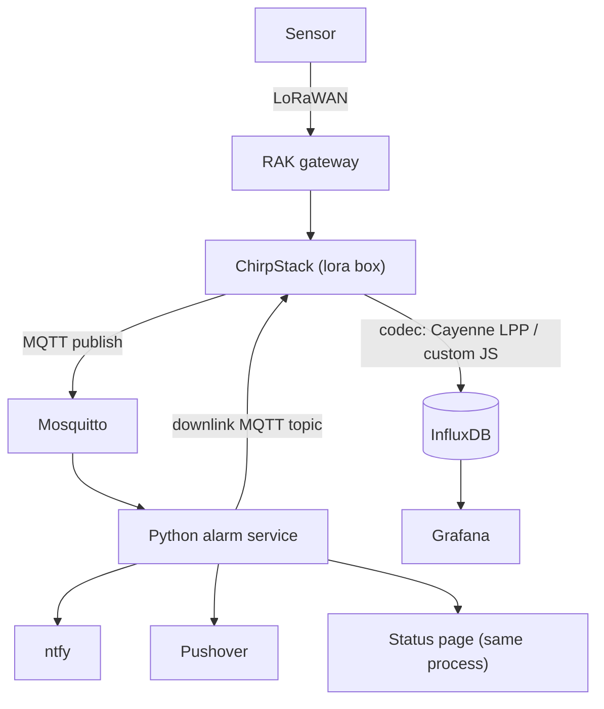

# LoRaLarm migration: Node-RED → ChirpStack + InfluxDB + Python

Working document for implementing the migration in VS Code with Mistral Vibe.
Companion repo: `github.com/tompatulpan/loralarm.org` (Node-RED flows in `server/node-red/`).

## 0. Status (2026-11-13)

Authoritative for *what exists*; the numbered sections below are the plan and
were corrected where they had drifted. Highest priority now: **modular
architecture v2** of the Python service — see
[`server/python/ARCHITECTURE.md`](../python/ARCHITECTURE.md) (design under review,
phases 0–6).

| Area | State |
|---|---|
| ChirpStack decode | ✅ five device families live: RUI3/Cayenne, RAK4631 custom, Dragino LDS02, Browan TBWL100 (water), Milesight WS101 (button, `ws101-decoder.js`) — codec copies + example configs + fixtures for all |
| Python service | ✅ runs live: alarms (temp low **and** high, with hysteresis), watchdog, ntfy + Pushover, per-device `alarm_window`, SQLite events, downlinks with read-back, hot-reloaded config, data-driven device families |
| Web / PWA in the service | ✅ first version built: FastAPI app (`loralarm/webapp.py`, `--web-host:--web-port`), static PWA (`PWA/web/`: manifest, service worker, silent push), users seeded from `devices.json` (`web_users`), token login, web push (VAPID), per-device arm/snooze/mute, group-based visibility, recent alarms, security headers. Optional deps via `requirements-web.txt` (web tests skip without it) |
| Python service architecture | 🔧 v2 phase 1 done; **phases 2–5 not started** (stateful detectors still in `AlarmState`, flat `DeviceConfig`, ntfy+Pushover hardwired). Alarm window + temp high alarm + web layer shipped ahead of v2 on the v1 structure |
| Runtime model | **Threaded, stdlib-only core** (paho thread + main-thread watchdog + web app in a uvicorn thread). Not asyncio — the original §7 wording is superseded |
| ChirpStack REST registry cache | ⏳ not built; deferred (v2 leaves a `DeviceSource` seam) |
| InfluxDB + Grafana | ⏳ no repo artefacts yet (no compose, no config); §11 step 4 unverified |
| Node-RED parallel run | 🔧 service replays real events and sends notifications; no recorded alarm-for-alarm comparison, no cutover decision yet |
| Seeded devices | ✅ all 10 in `devices.json` typed: sensor3/8/9/11/16 (RAK), Door1/2 (LDS02), water1/2 (TBWL100), Button 1 (WS101) |

Known gaps that v2 addresses: no hysteresis on battery, delivery results not
recorded, notification queue in memory only, one ntfy topic + one Pushover
recipient per device (temp now *has* hysteresis: `temp_alarm_hysteresis_c`).
**v2 phase 1 is done** (registry instance, frame/values with declared fields,
golden parity test, fixtures tracked); phases 2–5 are next. Shipped on the v1
structure since 2026-11-11: alarm windows (`schedule.py`, health kinds always
notify), temp alarms split low/high (`temp_alarm_min_c`/`temp_alarm_max_c`),
and the web/PWA layer above. Pushover never uses emergency priority any more
(stays 1/0; supersedes ARCHITECTURE §12.6's "critical → 2" — the repeat-until-ack
behaviour was unwanted).

## 1. Goal

Scale from ~16 sensors (sensor3–16 + doors/water, per-sensor Node-RED flow clones) to 400
devices. The per-sensor clone architecture (`nodered_copy_flow.py`, one flow JSON + one
dashboard tab per sensor) becomes unmaintainable around 30–60 sensors. Replace it with:

- **ChirpStack** = decode + device registry + ingest (no custom ingest code)
- **InfluxDB** = storage
- **Grafana** = dashboards / history
- **One Python service** = alarms, watchdog, downlinks, notifications, status page
- **ntfy + Pushover** = push (both, as today)

Adding sensor 401 = register it in ChirpStack + assign a device profile. Nothing else
changes — **target state**. Today every device needs its own `devices.json` entry
(ntfy topic, Pushover); architecture v2 fixes this with `defaults` + `groups` (and,
later, ChirpStack tags via the registry cache). A *new kind* of device (CO₂, water
level, …) must be one device-type JSON file, a new alarm behaviour one detector
module, a new output one channel module — never an edit in core.

## 2. Architecture



Per uplink:

1. Sensor → RAK gateway → ChirpStack (lora box, Debian, existing).
2. ChirpStack decodes per device-profile codec (Cayenne LPP built-in for RUI3;
   custom JS codec for the RAK4631 Android binary frame).
3. ChirpStack writes decoded fields + metadata to InfluxDB (`device_frmpayload_data_*`,
   tags `dev_eui`, `device_name`, `application_name`, `f_port`), and publishes the uplink
   event to Mosquitto (`application/+/device/+/event/up`).
4. Python service consumes MQTT, applies per-device config and alarm state machine.
5. Alarms → ntfy + Pushover, one log line to the events table; status page reflects state.

## 3. Verified facts (2026-11-09)

- ChirpStack v4 InfluxDB integration confirmed working path; naming rules verified
  against live data (sensor16, devEUI `ac1f09fffe12da63`, application `Larm`,
  profile `RAK3172`).
- Cayenne decode verified live: uplink on **fPort 2**, decoded `object`:

```json
{
  "voltage":          { "1": 2.97 },
  "temperatureSensor": { "2": 22.7 },
  "humiditySensor":   { "3": 48.5 },
  "accelerometer":    { "6": { "x": 0.24, "y": 0.032, "z": 0.976 } },
  "digitalInput":     { "7": 30, "8": 4, "9": 1, "10": 2 }
}
```

- Expected InfluxDB measurements for that frame (nested keys joined by `_`,
  camelCase → snake_case):

```
device_frmpayload_data_voltage_1            = 2.97
device_frmpayload_data_temperature_sensor_2 = 22.7
device_frmpayload_data_humidity_sensor_3    = 48.5
device_frmpayload_data_accelerometer_6_x / _y / _z
device_frmpayload_data_digital_input_7 ... _10
+ uplink meta measurement (rssi, snr, f_cnt)
```

- Verification flow: Live event log (`up` event, look for `object`) → InfluxDB query →
  Grafana. **Device → Metrics tab shows network stats only, not decoded values.**
- Old events in the Live event log keep their old decode state; only judge fresh uplinks
  after a codec change.

## 4. Sensor protocols

Five device families are live (RUI3 and RAK4631 below; the others are third-party
codecs: **Dragino LDS02** door switch, fPort 10, `BAT_V`/`DOOR_OPEN_STATUS`,
battery 3.0/2.5/2.2 V assumed, no settings or downlinks; **Browan TBWL100**
water-leak sensor; **Milesight WS101** smart button, `ws101-decoder.js`). The two
LoRaLarm firmware families:

| | RUI3 sensors (e.g. RAK3172) | RAK4631 Android |
|---|---|---|
| ChirpStack profile | RUI3 profile (Cayenne LPP) | RAK profile (custom JS codec) |
| Sensor-data port | fPort 2 (Cayenne) | fPort 2 (14-byte binary custom frame) |
| Settings / acks | fPort 4–7, ASCII-decimal | fPort 4–7, ASCII-decimal |
| ChirpStack app key | `sublarm` | `larm` |
| `Tk` correction | 0 °C | 8 °C (subtract from raw temperature) |
| `tempAlarmLimit` | 0 °C | 2 °C (alarm at or below) |
| `battFull/Warn/Empty` | 3.1 / 2.9 / 2.8 V (3 V cell) | 4.2 / 3.5 / 3.2 V |
| Channels | per `devices/rui3_sensor/app.h` | battery as raw ADC in frame |

**Key design rule:** codecs stay *pure raw decoders* (one per sensor family, identical
for all devices). All per-device values (`Tk`, battery thresholds, `tilt_sense`,
`tempAlarmLimit`, ntfy topic) live in the Python service config. No per-device codec
copies. `auto` protocol detection from the Node-RED flow is unnecessary: the profile
binding guarantees the right codec.

Under architecture v2 the per-device values move into the **device type's declared
params** (`tk_correction_c`, `batt_*`, `temp_alarm_limit_c`, …) with defaults per
type and overrides per group/device in the service config. A third-party codec
(Dragino) is never edited: the type's `fields` map its names to measurements.

## 5. Codecs

All five device-profile codecs are implemented and verified working (RUI3:
Cayenne LPP; RAK4631: custom JavaScript; Dragino LDS02:
`payload_codec_dragino_lds02.js`; Browan TBWL100 and Milesight WS101:
`payload_codec_browan_tbwl100.js`, `ws101-decoder.js`).
Canonical copies live in git at `server/chirpstack/payload_codec_*.js` (ChirpStack
stores them in its DB; without git copies they will drift). The real-event fixtures
that guard the codecs and the Python service live in
`server/chirpstack/fixtures/` (tracked; previously the git-ignored `log/`).

## 6. ChirpStack + InfluxDB config

- Enable InfluxDB integration in `chirpstack.toml` (InfluxDB 2.x: url, org, token,
  bucket) and per-tenant flag. Restart ChirpStack after config changes.
- Verify: `influx query 'from(bucket:"<bucket>") |> range(start: -1h)
  |> filter(fn: (r) => r._measurement =~ /device_frmpayload_data_/) |> limit(n: 20)'`
- ChirpStack stays the **single device registry** (EUIs, names, profiles). Python queries
  the ChirpStack REST API at startup and caches in RAM; refresh on interval.
  *(Not built yet; deferred until after architecture v2. Until then identity comes from
  uplink events plus `devices.json`.)*
- `flow_inputs.json` is retired: devEUI→name mapping comes from ChirpStack.

## 7. Python alarm service (one threaded process)

> **Superseded details.** The service is threaded and stdlib-only apart from
> `paho-mqtt` (ntfy/Pushover over `urllib`), several thousand lines with tests, and is
> being restructured per [`server/python/ARCHITECTURE.md`](../python/ARCHITECTURE.md).
> Items below describe *responsibilities*; where they name config keys
> (`temp_alarm_c`, `tk_correction`, …) or modules, ARCHITECTURE.md and
> `server/python/README.md` win. The web layer is now built (`webapp.py`, FastAPI
> in a uvicorn thread, deps in `requirements-web.txt`); `httpx` and
> `influxdb-client` remain unused until their features are built.

Responsibilities:

1. **MQTT in:** subscribe `application/+/device/+/event/up` (and `/downlink` if needed).
   Use the decoded `object` from ChirpStack for sensor-data uplinks. Settings/response
   frames on fPort 4–7 (ASCII-decimal, both families) are not codec output:
   the service parses them itself (base64 → ASCII).
2. **Registry cache:** devices + names + types from ChirpStack REST API at startup,
   periodic refresh. Per-device config from a local config file (YAML/JSON) keyed by
   devEUI or device name: `temp_alarm_c`, `batt_full_v`, `batt_warn_v`, `batt_empty_v`,
   `tilt_sense`, `ntfy_topic`, `tk_correction`.
3. **Alarm state machine** (port of the Node-RED alarm subflow):
   - temperature ≤ `tempAlarmLimit` (after `Tk` correction)
   - door/circuit state open too long (digital inputs 7–10 → `circuitTs/Led/Count/Status`)
   - motion / tilt (accel vs `tilt_sense` g-units)
   - water (door/water sensor types)
   - battery < warn / < empty (from `battFull/Warn/Empty` → percent + status)
   - watchdog: no uplink within N hours → stale
   - fire **once on alarm, once on clear**, hysteresis/debounce like current subflows.
4. **Downlinks:** publish to ChirpStack MQTT downlink topic (reboot, LED, settings
   writes as ASCII-decimal on ports 4–7). Frequency code translation: custom register
   value (31/47/63/79/95) ↔ RUI3 index 1–5.
   Implemented in `server/python/loralarm/downlink.py`: CLI
   (`python3 -m loralarm.downlink --dev <devEui|name> --set frequency=50 ...`) and,
   in the live service, a command topic `loralarm/down/<devEui-or-name>`
   (`--dl-topic`). Every downlink is logged to the events table (`kind="downlink"`).
5. **Notifications:** every alarm → ntfy (per-sensor topic, self-hosted) **and** Pushover
   (token/user per device in config). One function, two channels.
6. **Events log:** alarms/clears/downlinks to a small `events` table (SQLite to start;
   Postgres/Timescale later if fleet dashboards need it).

Deliberately **not** in the service: ingest (ChirpStack→Influx does it), decoding
Cayenne fPort 2 (ChirpStack already did it), dashboards (Grafana).

## 8. Grafana

- Datasource: InfluxDB 2.x (Flux).
- One per-family dashboard with `device_name` variable dropdown (populated from tag).
  No per-sensor dashboards, ever.
- Optional fleet dashboard: battery levels sorted, stale count, alarm counts (from
  aggregates). Grafana "no data" alerts optional as a watchdog backstop only;
  threshold alarms belong to Python.

## 9. Status page (same Python process)

> **Pointer.** The status page and the PWA are one surface; the authoritative design
> is [`PWA/docs/pwa-design.md`](../../PWA/docs/pwa-design.md) (FastAPI in a uvicorn
> thread, `Engine.snapshot()`, no charts, Grafana deep-links). The list below is the
> original requirement set and is kept for the Statuspanel parity checklist.

- Alarm banner: current alarm state from the service's own RAM (instant), green
  "Alla sensorer OK" when empty. Swedish UI labels, replacing the `Statuspanel`
  Node-RED dashboard.
- Fleet table: name, last seen (relative), battery, alarm state; problem devices sort
  first. Data from InfluxDB (last seen, battery) + ChirpStack API.
- Alarm history: last 24h from `events`.
- Auto-refresh 15–30 s via HTMX or plain fetch fragment polling. No JS framework.
- Per-device history deep-links to Grafana instead of reimplementing charts.

## 10. Deployment

| Host | Runs | Notes |
|---|---|---|
| lora box (existing) | ChirpStack, Mosquitto, gateway bridge | unchanged + InfluxDB integration config |
| blue-104 (or successor) | InfluxDB, Grafana, ntfy, Python service | one docker-compose stack, everything in git |

- Python service and Influx/Grafana containers under `server/` in the repo.
- Node-RED keeps running in parallel during migration (MQTT fans out to both) and is
  retired per-sensor-type once Python output matches.
- Registry DB/ChirpStack is the asset that must be backed up; test restore path.

## 11. Migration checklist (order)

1. ✅ Cayenne codec verified live on RUI3 (sensor16) — raw + decoded in event log.
2. ✅ Confirmed old log entries keep old decode state; only fresh uplinks count.
3. ✅ Both device-profile codecs implemented and working (RUI3 Cayenne, RAK custom JS).
4. ⏳ Verify `device_frmpayload_data_*` measurements in the Influx bucket (§6 query).
5. ❓ Bind remaining RUI3 devices to the RUI3 profile (not recorded; confirm).
6. 🔧 Settings downlink round-trip: implemented with read-back confirmation
   (`downlink_ok` events); confirm it was exercised on each family.
7. 🔧 Python service written (§7) and running; **parallel run vs Node-RED not yet
   compared.** Define the criterion first: N days, alarm-for-alarm diff per device,
   zero missed alarms.
8. 🔧 Status page / PWA: **first version built** (FastAPI in a uvicorn thread,
   `webapp.py`; static PWA in `PWA/web/`; web push, arm/snooze/mute, group
   visibility, recent alarms). Live deployment and parity with the PWA brief
   not yet verified.
9. ⏳ Cut over notifications (disable Node-RED ntfy/Pushover nodes), then retire flows:
   `flow_inputs.json`, `nodered_copy_flow.py`, per-sensor flow JSONs. Cutover should
   wait for architecture v2 phases 1–4 (hysteresis, delivery log, persistent outbox)
   so the first production notifications come from the final delivery path.
10. ⏳ Backup + tested restore of ChirpStack DB and `loralarm.db`.

## 12. Open items / TODO

- [x] Downlink path confirmed: Python → ChirpStack MQTT `application/<appId>/device/<devEui>/command/down`
      with `{"devEui", "confirmed", "fPort", "data": base64}` — raw `data` bypasses the codec;
      `object` would go through `encodeDownlink` (kept as the alternative). Implemented in
      `server/python/loralarm/downlink.py`.
- [ ] Confirm the InfluxDB meta measurement name in this ChirpStack version (rssi/snr).
- [x] Events store choice: SQLite (events, device state; delivery + outbox tables planned in v2).
- [ ] ChirpStack version pinned (codec copies are in `server/chirpstack/payload_codec_*.js`).
- [ ] **Architecture v2** (`server/python/ARCHITECTURE.md`): phase 1 done;
      **phases 2–5 open** (Detector API, config layering, channels/dispatcher
      + delivery log + outbox, engine split).
- [x] Device types for Button 1 and water1/water2 added: Milesight WS101
      (`ws101-decoder.js`, `families/milesight_ws101.json`, `watchdog_hours` 0 —
      reports only on press) and Browan TBWL100 (`payload_codec_browan_tbwl100.js`,
      `families/browan_tbwl100.json`).
- [x] Per-device alarm window (e.g. `21:00-09:00`, overnight ok): shipped
      2026-11-11 (`schedule.py`); outside the window an alarm is logged but not
      sent, health kinds (temp/battery/stale) always notify. README "Alarm window".
- [x] High-temperature alarm: `temp_alarm_max_c` (+ `temp_alarm_hysteresis_c`
      for both limits). Pushover stays priority 1/0 — emergency (2) removed.
- [ ] ChirpStack REST registry cache (`DeviceSource` seam) — after v2.
- [ ] Alarm-storm handling (gateway outage → many `stale` at once): per-channel
      queues, priority lanes, optional rollup — v2 phase 4.
- [ ] Define Node-RED retirement criteria (see §11 step 7).
- [ ] LDS02 battery limits (3.0/2.5/2.2 V) are an assumption; check a real discharge.

## 13. Verification snippets

Offline Cayenne frame decode (any box with Python, pass base64 from an uplink event):

```python
import base64, sys
TYPES = {0x00:("digital_in",1),0x01:("digital_out",1),0x02:("analog_in",2,0.01),
         0x03:("analog_out",2,0.01),0x67:("temperature",2,0.1),
         0x68:("humidity",1,0.5),0x71:("barometer",2,0.1),
         0x73:("illuminance",2,1),0x83:("gyrometer",6,0.01),
         0x84:("accelerometer",6,0.001)}
data = base64.b64decode(sys.argv[1]); i = 0
while i < len(data):
    ch, t = data[i], data[i+1]; i += 2
    name, n, *scale = TYPES.get(t, ("unknown:"+hex(t), 0, 1))
    raw = int.from_bytes(data[i:i+n], "big", signed=name=="temperature"); i += n
    print(f"channel {ch}: {name} = {raw*scale[0]}")
```

Debug rules of thumb: `object` missing on a fresh uplink → codec not applied (check
profile binding + save) or frame not valid for that codec (wrong port/family);
`object` present but Influx empty → integration config/tenant flag/restart.