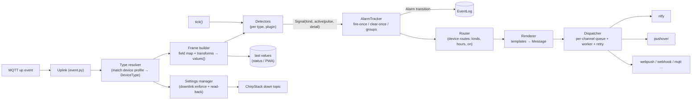

# LoRaLarm service — architecture v2 (design, for review)

Status: **phase 1 implemented (2026-11-11), phases 2–6 still proposals** — see
"Phase 1: as built" at the end of §10. Decisions taken (2026-11-11):
threaded runtime (stdlib-only core), **clean break** of the config schema
(`devices.json` is migrated by hand), ChirpStack registry cache **deferred**
(see §11), implementation in phases (§10) after this document is approved.

Related: migration spec
(`../chirpstack/loralarm-node-red-→-chirpstack-+-influxdb-+-python-migration-spec.md`),
PWA brief (`../../PWA/docs/pwa-design.md`), current behaviour in `README.md`.

## 1. Why

The v1 service is already partly data-driven (family JSON, declarative rules),
but a new *kind of thing* still means touching core code:

| Today | Consequence |
|---|---|
| `Reading` = temperature + battery + rssi/snr | A CO₂, water-level or humidity sensor has nowhere to put its value; the status page / PWA cannot show it |
| `evaluate()` computes temp (`Tk`) and battery % itself | Calibration is device-specific knowledge living in core |
| Tilt, pulse-motion, pulse-circuit hardcoded in `AlarmState.update` with fixed snapshot fields | A new stateful detector = edit core + snapshot format |
| `DeviceConfig` is one flat dataclass (ACC, motion, circuit fields on every device) and `_FIELD_TYPES` | Config schema grows with every device type; typo checks cover core keys only |
| Channels = ntfy + Pushover as flat keys (`ntfy_topic`, `pushover_user`, …) | No second recipient, no time windows, no web push without editing `Notifier._deliver` |
| Rules/profiles are module-level globals with "undo on reload" bookkeeping | Hard to test, hot-reload fragile |
| `Engine` (≈640 lines) mixes evaluation, config reload, downlink enforcement, console output | Every feature touches the same class and the same lock |
| Device-kind gating (`sensor`/`door`/…) as a second dimension next to the profile | Two places to say "what does this device do" |

**Goal:** adding a device type, an alarm behaviour, or an output channel is
*one file* (JSON for data, one Python module for new logic) and never an edit
in `engine`, `alarms`, `notify` or `downlink`.

## 2. Principles

1. **Declare, don't code.** Device types are JSON. Python is only needed for a
   genuinely new *behaviour* (a detector) or *destination* (a channel).
2. **Small closed core, open plugins.** The core knows `Frame`, `Signal`,
   `Alarm`, `Message`. It does not know "temperature", "ntfy" or "tilt".
3. **No module-level mutable registries.** A `Registry` instance is built at
   startup and passed in; tests build their own.
4. **Every plugin owns its state and its params**, declares them (schema), and
   is validated at config load. Unknown/misspelled keys are reported, not ignored.
5. **Alarm lifecycle is generic.** Detectors say *"condition holds / pulse"*;
   one `AlarmTracker` does fire-once/clear-once, escalation groups, persistence.
6. **Delivery is isolated per channel.** A slow or broken channel never delays
   another, and never delays evaluation.
7. **The codec stays the device boundary** (unchanged rule): codecs decode,
   Python adds meaning (calibration, thresholds, routing).
8. **Parity first.** Each phase must replay the captured real uplinks to the
   same transitions and notification texts as v1 before it is merged (§9).

## 3. Pipeline



Threading is unchanged: `on_uplink` on the paho thread, `tick()` on the main
thread, one engine lock; each channel owns its worker thread (§7). The web
layer (PWA) later reads `Engine.snapshot()`.

## 4. Core concepts

### 4.1 Frame and values

`Frame` is the evaluated uplink: `dev_eui`, `time`, `f_port`, `rssi`, `snr`,
`raw` (the codec object, normalized) and **`values: dict[str, Value]`**.
`Value = number | bool | str | dict` — whatever the type's `fields` produce.
Nothing in core reads `values["temperature"]`; only detectors and the UI do.

Replaces `Reading`. Persisted per device (`last_values`, `last_frame_time`) so
status page / PWA can show any measurement without InfluxDB.

### 4.2 Device type (replaces *profile/family* and the `kind` gating)

One JSON file per type in `loralarm/types/`, plus optional inline
`"types"` in `devices.json`. A device type declares everything about the
hardware; the ChirpStack device-profile name only *selects* it.

| Key | Meaning |
|---|---|
| `id`, `description` | Identity |
| `match` | ChirpStack device-profile names / aliases (case-insensitive); no match → `generic` |
| `extends` | Another type id (deep-merged). `rak3172` and `rak4631` share `acc-sensor` |
| `ports` | `{ "data": [2], "settings": [4,5,6,7] }` — which fPorts are sensor data vs. settings/ack frames |
| `params` | Schema of the knobs this type exposes: `{name: {type, default, unit?, min?, max?}}` |
| `fields` | Measurement declarations (§4.3) |
| `detectors` | List of detector instances (§5) — **this replaces `device_kinds` gating**: a door type simply doesn't list `tilt` |
| `settings` | Downlink-writable settings (§8) |
| `defaults` | Layer-1 values for `params` and `notify` |

A device never has a `kind`; its behaviour *is* its type's detector list.

### 4.3 Fields, transforms, derived values

```json
"fields": {
  "temperature": {"from": "temperature", "unit": "°C",
                  "transform": [{"op": "offset", "by": "-$tk_correction_c"}, {"op": "round", "n": 2}]},
  "battery_v":   {"from": "battery_voltage", "unit": "V"},
  "battery_pct": {"derive": "linear_pct", "of": "battery_v",
                  "empty": "$batt_empty_v", "full": "$batt_full_v"},
  "door_open":   {"from": "DOOR_OPEN_STATUS", "type": "bool"}
}
```

- `from` replaces today's `field_map` (third-party codec names) and the
  "canonical codec fields" table: a type states what it reads, so the codec
  contract becomes *any* names, as long as the type maps them.
- `$name` references a type param (resolved per device from the layered config).
- Transform ops are a plugin point (`offset`, `scale`, `round`, `clamp`,
  `map`, `linear_pct`, `lookup` built in).
- A missing source field yields no value (detectors see "absent", never 0).

### 4.4 Signals, alarms, kinds

An alarm **kind** stays a plain string (`temp`, `battery_low`, `leak`, …) and
is owned by the detector that declares it, with `label` and `severity`
(`critical | warning | info`).

A detector returns `Signal`s:

```python
Signal(kind="temp", active=True,  detail="…")           # level: holds while true
Signal(kind="circuit", active=True, detail="…", pulse=True)   # edge: fire-only, no clear
```

`AlarmTracker` (generic, one per device) turns signals into **transitions**
(`fire` / `clear`), applies escalation `group`s (battery low ⇄ empty is not a
clear), and persists `active` + `last_detail`. `stale` is a detector like any
other (see 5.1), no special case in the tracker.

### 4.5 Config layering (clean break)

```json
{
  "version": 2,
  "channels": {
    "ops-ntfy":    {"type": "ntfy",     "topic": "loralarm-ops"},
    "tomas-push":  {"type": "pushover", "user": "${PUSHOVER_USER}", "token": "${PUSHOVER_TOKEN}"},
    "night-push":  {"type": "pushover", "user": "${PUSHOVER_USER2}", "token": "${PUSHOVER_TOKEN}"}
  },
  "defaults": {
    "params": {"watchdog_hours": 24},
    "notify": [{"to": "ops-ntfy"}]
  },
  "groups": {
    "coldrooms": {"params": {"temp_alarm_limit_c": 4}, "notify": [{"to": "tomas-push"}]}
  },
  "devices": {
    "ac1f09fffe1003ae": {
      "name": "sensor3", "type": "rak4631", "groups": ["coldrooms"],
      "params": {"motion_min_detections": 3},
      "notify": [
        {"to": "ops-ntfy", "topic": "sensor3"},
        {"to": "tomas-push"},
        {"to": "night-push", "hours": "21:00-09:00", "kinds": ["motion", "circuit"]}
      ],
      "settings": {"threshold": 8, "frequency": "hz:10", "duration": 1}
    }
  }
}
```

- **Layer order** (later wins): `type.defaults` < `defaults` < `groups[...]`
  (in the order listed on the device) < `devices[eui]`. `params` merge
  key-by-key. `notify` is replaced by the most specific layer that sets it
  (explicit beats magic merging).
- **Named channels** carry credentials once; a device references them. A device
  route may override channel fields (`topic`), filter (`kinds`, `severity`,
  `on: ["fire","clear"]`) and restrict time (`hours`). This covers the todo
  items *multiple Pushover/ntfy outputs per device*, *alarm window 09–21* and
  per-device topic without extra config keys.
- **Groups** are the 400-device answer: set limits/recipients for "all cold
  rooms" once. A ChirpStack **tag** → group mapping is the natural follow-up
  once the registry cache exists (§11).
- A device missing from `devices` still works (type from the uplink's profile,
  `defaults` routes) and is logged once, as today.
- `${ENV}` expansion, hot-reload with keep-previous-on-error: unchanged.
- Validation is schema-driven: type params, detector params, channel params and
  routes are checked against their declared schemas; unknown keys and wrong
  types are warnings naming the layer and the key.

## 5. Detectors

```python
class Detector:                       # loralarm/detectors/base.py
    type: ClassVar[str]               # "threshold"
    params: ClassVar[dict]            # schema of the instance config (id, field, op, limit…)

    def __init__(self, spec: Mapping, resolve: Resolver): ...
    def update(self, frame: Frame, state: dict) -> list[Signal]: ...
    def tick(self, now: datetime, state: dict, ctx: TickCtx) -> list[Signal]: ...   # optional
    def clear_text(self, frame: Frame | None) -> str: ...                            # optional
```

`state` is a JSON-serialisable dict **private to that detector instance**,
stored under `detectors.<id>` in the device snapshot. Core never looks inside.

### 5.1 Built-in detectors (all current behaviour, no special cases left in core)

| Type | Replaces | Notes |
|---|---|---|
| `threshold` | `temp`, `battery_*`, humidity-style rules | `op` gt/ge/lt/le/eq/ne, `limit` (`$param` or literal), optional `hysteresis` and `debounce` (N consecutive samples) — closes the open *no hysteresis* todo; optional `levels` list (first match wins, ordered most severe first) for low/empty ladders with an escalation `group` |
| `flag` | `door`, `leak`, level `circuit`/`motion` | truthy/falsy/eq on a field |
| `pulse` | event-mode `circuit` | every frame with the bit is a fire-only alarm, `hold_s` merges bursts |
| `window_count` | event-mode `motion` | ≥ `min` detections within `window_s`; fire-only; burst latch |
| `baseline_deviation` | `tilt` | EMA baseline per axis, ± `sense`, re-baseline after N frames |
| `stale` | watchdog | `after_hours` (`$watchdog_hours`); active until the next frame; clear text "uplink mottagen". Implicit in every type, can be overridden/disabled |

`level` vs `event` modes disappear as config flags: a type simply lists `flag`
or `pulse`/`window_count` for that input. (`rak3172` lists `flag` for the
switch; `rak4631` lists `pulse`.)

### 5.2 Writing a new detector (Python)

One module in `loralarm/detectors/` (or any directory passed with
`--plugins`) with a `@detector("rate_of_change")` class. It is available in
type JSON immediately; its `params` schema is enforced at config load; its
state is persisted for free. A conformance helper
(`tests/kit.py: DetectorKit`) feeds frames and asserts signals/state
round-trip.

## 6. Messages, routing, rendering

- `AlarmEvent` (after the tracker): `event_id` (logged **first**, as the PWA
  design requires), device, kind, `active`, `severity`, `detail`, `ts`.
- **Router**: per device, `notify` routes → `(channel, overrides)` pairs after
  filtering by `kinds` / `severity` / `on` / `hours`.
- **Renderer**: text comes from, in order: device/type template for the kind →
  detector's own `fire`/`clear` text → generic
  `"{name}: {label} LARM|kvitterad — {detail}"`. Built-in emoji texts move from
  `notify.DEFAULT_TEXT` into the detector/type JSON that owns the kind.
  `Message = {title, body, severity, tags, event_id, dev_eui, kind, active}` —
  channel-neutral; channels map severity to their own priority.

## 7. Channels and delivery

```python
class Channel:                         # loralarm/channels/base.py
    type: ClassVar[str]                # "ntfy" | "pushover" | "webpush" | "webhook" | "mqtt"
    params: ClassVar[dict]             # schema, e.g. topic / user / token
    def send(self, msg: Message, target: Mapping) -> None   # raise Retryable / Permanent
```

- **Dispatcher** owns **one bounded queue + worker thread per channel
  instance**, with per-channel retry/backoff and a per-priority lane so
  `stale` traffic can never sit in front of a frost alarm.
- **Delivery log**: every attempt/result recorded (`delivery` table:
  `event_id, channel, status, attempts, http_code, ts`) — closes the open
  *delivery results not recorded* todo and gives the PWA ack metric a home.
- **Persistent outbox** (SQLite): enqueue = insert; worker marks done. A
  restart re-delivers undelivered, un-expired messages (TTL per severity) —
  closes the open *queue is memory-only* todo.
- **Storm control** (optional policy, phase 4): N `stale` transitions inside
  M seconds collapse into one rollup message ("37 enheter utan kontakt —
  gateway?"); critical kinds are never rolled up.
- Built-ins: `ntfy`, `pushover` (priority 2 for `critical` with retry/expire,
  per the PWA brief). Later: `webpush` (PWA), `webhook`, `mqtt`.
- Credentials stay in named `channels`, expanded from env; never in type files.

## 8. Settings / downlinks

Behaviour is unchanged (ChirpStack MQTT `command/down`, raw base64 on ports
4–7, read-back confirmation, resend limits) but it leaves the engine:

- `SettingsManager` (own module, own state): desired vs reported comparison,
  `_dl_sent`, resend limits, confirm. Engine only calls
  `settings.on_frame(device, frame)`.
- `settings` in a type become fully generic specs:

```json
"settings": [
  {"key": "threshold", "port": 5, "range": [1, 127], "report": "acc_threshold"},
  {"key": "frequency", "port": 6, "report": "acc_frequency",
   "codec": {"type": "enum", "label": "code",
             "map": {"31": 1, "47": 10, "63": 25, "79": 50, "95": 100}}},
  {"key": "duration",  "port": 7, "range": [0, 127], "report": "acc_duration"},
  {"key": "command",   "port": 4, "range": [0, 255]}
]
```

The special `kind: frequency` and the cross-profile Hz translation tables become
a generic **enum map** with `unit` (Hz): the translation logic stays, but
`downlink.py` no longer knows the word "frequency". Wire encoding is also a
codec (`ascii3` today; `u8`, `hex` later) so non-ASCII-decimal devices fit.
Settings are keyed per type; a type with no `settings` is never auto-pushed
(no more `settings_kinds`).

## 9. Persistence and state

- Snapshot v2 per device:
  `{"v": 2, "last_seen", "last_values", "tracker": {"active", "last_detail"}, "detectors": {"<id>": {…}}}`.
- Clean break on config, but **state migration is cheap and avoids a re-fire
  storm** on first start: a one-off converter maps v1 `active` / `last_seen`
  into v2 and discards detector internals (baselines re-learn).
- `events` stays append-only; `delivery`, `outbox` and (later) PWA tables go
  through `EventLog` (single connection + lock, WAL when the web side attaches).

## 10. Package layout and phases

```
loralarm/
  core/        model.py (Frame, Value, Signal, AlarmEvent, Message)
               registry.py (Registry: detectors, channels, transforms, types)
               tracker.py (AlarmTracker) · engine.py (pipeline, lock, tick)
  types/       loader.py · schema.py · *.json   (rak3172, rak4631, dragino_lds02, acc-sensor, generic)
  detectors/   base.py threshold.py flag.py pulse.py window_count.py baseline.py stale.py
  transforms/  builtin.py
  channels/    base.py ntfy.py pushover.py · dispatcher.py · outbox.py
  settings/    manager.py · codecs.py          (downlink logic, was downlink.py + Engine parts)
  config/      loader.py (layering, ${ENV}, hot reload) · validate.py
  store/       events.py
  transport/   mqttclient.py · event.py
  cli/         replay.py · downlink.py
  plugins/     (user drop-in directory, optional)
```

Dependency rule: `core` imports nothing from `detectors/`, `channels/`,
`transforms/`; they register themselves into a `Registry`.

| Phase | Deliverable | Exit criteria |
|---|---|---|
| **0** | This document + updated migration spec | Reviewed/approved |
| **1** ✅ | **Foundation.** Move replay fixtures into git (`../chirpstack/fixtures/`, shared with the codec test); `Registry` instance replaces module globals; `Frame/values` + field transforms replace `Reading`; battery % becomes a derived field; `last_values` persisted | Golden replay identical (12 scenarios: console, notifications, alarm state); existing tests green or ported |
| **2** | **Detectors.** `Detector` API, built-ins §5.1, generic `AlarmTracker`, snapshot v2 (+ v1 converter), hysteresis/debounce | Parity on fixtures; per-detector unit tests; `alarms.py` reduced to compatibility-free glue or deleted |
| **3** | **Config v2.** Layering with groups, schema-driven validation, `extends`, params schema, named channels + routes (config only, still delivered by old notifier) | Hand-migrated `devices.json` loads; typo/unknown-key warnings per layer; hot reload preserved |
| **4** | **Channels.** `Channel` API, Dispatcher (per-channel workers), ntfy/pushover plugins, delivery log, persistent outbox, severity→priority, optional storm rollup | A channel outage does not delay another (test); restart redelivers; delivery rows queryable |
| **5** | **Decompose engine.** `SettingsManager`, generic setting codecs/enum maps, package re-layout, plugin directory loader, README rewritten (recipes: new type = JSON, new detector, new channel) | `engine.py` ≈ pipeline only; adding a fake "CO₂ sensor" type + a new detector + a new channel requires **no edits** in core (a test proves it) |
| **6** (later) | ChirpStack registry source, `webpush` channel + `Engine.snapshot()` for the PWA, Influx/Grafana compose | Per spec §11 / PWA brief |

Each phase ends with: all tests green, offline replay parity, README section
updated. No phase leaves the service unrunnable.

### Phase 1: as built

Done and verified by `tests/test_golden.py` (12 scenarios, generated from the
code *before* the refactor): identical console output, ntfy/Pushover messages
and alarm state. Where the implementation deliberately differs from, or
narrows, the plan above:

- **Fixtures** live in `server/chirpstack/fixtures/` (renamed from the ignored
  `log/`), tracked, and shared by the codec test (`node payload_codec_test.js`)
  and the Python golden test. The old "skip if missing" guard is gone.
- **`Registry`** (`loralarm/registry.py`) holds rules, profiles, transforms and
  derivations. `builtin_registry()` is the shared base; each `Config` forks it
  and applies the `"profiles"` section of `devices.json`, so hot reload swaps a
  registry instead of undoing global edits. `Engine.registry` is the current
  config's. Rules are still `AlarmRule` objects (the detector API is phase 2);
  detectors/channels are not in the registry yet.
- **Fields** (`loralarm/frame.py`): `Frame.values`; `from` / `transform` /
  `derive` as designed. `field_map` and `DeviceProfile.normalize` are gone
  (config clean break). Two pragmatic choices: **undeclared codec fields pass
  through** into `values` (so rules and the status page can read anything, and
  existing rules such as `motion_alert` need no declaration), and the standard
  temperature/battery fields (`STANDARD_FIELDS` in `profiles.py`) apply to every
  type unless it declares one of the same name — the type-level `extends`
  mechanism of phase 3 will replace that implicit inheritance.
- **Battery** is `battery_voltage` + derived `battery_pct` (`linear_pct`) and
  `battery_status` (`band`, same boundaries as the old code). The rules read the
  status, so the thresholds are no longer computed in core.
- **Rule signature** is now `check(cfg, frame, values)` / `clear(cfg, frame)`;
  `values` is `frame.values`. `Reading` is removed.
- **`last_values`, `last_rssi`, `last_snr`** are kept per device and persisted
  in the state snapshot (old snapshots restore fine); nothing reads them yet
  (status page / PWA).
- **Notifier** takes the registry with each notification (labels and rule texts
  come from it); its `notify()` gained an optional `registry` argument.
- **Tests**: `tests/common.py` offers registry-bound `AlarmState`, `evaluate`
  and `clear_detail` helpers; `tests/test_frame.py` includes a CO₂ sensor type
  defined purely in JSON.
- **Not changed on purpose** (parity): the console line still prints
  `temp=None` for devices without a temperature. Phase 2/5 can make the console
  generic.

## 11. Deliberately deferred

- **ChirpStack REST registry cache** (names, profiles, tags → groups). The
  design leaves one seam for it: a `DeviceSource` that yields `(dev_eui, name,
  profile, tags)` merged *under* `devices.json`. Until then devices.json plus
  learned-from-uplink identity stays the source (and the 400-device onboarding
  story is `groups` + `defaults`, not per-device entries).
- **asyncio.** Rejected for now: the PWA brief assumes the threaded model and
  the core stays stdlib-only. Per-channel workers give the isolation async
  would.
- **YAML** config. JSON stays; PyYAML can replace the loader later behind
  `config/loader.py`.
- **Per-user subscriptions / arm-disarm.** PWA scope; they hook in at the
  Router (`armed` check before fan-out) and the `webpush` channel.

## 12. Risks and open questions

1. **Parity risk.** Mitigation: fixtures in git first (phase 1), golden
   transitions *and* rendered notification texts compared per phase.
2. **State loss on upgrade.** Mitigation: v1→v2 snapshot converter (§9).
3. **Plugin trust.** `--plugins` executes Python from a directory; it is the
   operator's own code (same trust as the service itself), documented as such.
4. **Config surface growth.** `groups` + `extends` + named channels are the
   cost of flexibility; mitigated by schema validation and
   `python -m loralarm.config --explain <device>` (shows the resolved layers),
   planned in phase 3.
5. **`notify` across layers — DECIDED (2026-11-11): replace.** The most specific
   layer that sets `notify` wins completely; a device that wants the default
   recipients too lists them again. No additive `notify+`.
6. **Severity → priority — DECIDED (2026-11-11):** `critical` → Pushover 2 /
   ntfy 5, `warning` → 1 / 4, `info` (incl. all "cleared" messages) → 0 / 3.

## 13. Alarm window (`alarm_window`) — implemented 2026-11-11

Status: **implemented** (`loralarm/schedule.py`, `Engine._should_notify`,
`tests/test_schedule.py`, `tests/test_alarm_window.py`, golden scenario
`alarm_window`; user documentation in README "Alarm window"). Differences from
the plan below: the engine remembers the alarms whose fire was *suppressed*
(`AlarmState.suppressed`) instead of those that were notified, which is
fail-safe (an unknown state, e.g. an old snapshot, still sends the clear) and
needs no snapshot migration; the event marker reads `(utanför larmtid
21:00-09:00, ej skickat)`. The plan text is kept for the reasoning.

Goal (todo.txt): per device, only notify inside a daily time window, e.g. no
door alarms during the day on some doors. Independent of phases 2–4: it is a
small change in the Engine's emit path that works with today's flat config, and
phase 3 later turns it into a route filter without changing the behaviour.

### 13.1 Behaviour (decided 2026-11-11)

- `"alarm_window": "21:00-09:00"` — notifications are sent only while the local
  time is inside the window. Start is inclusive, end exclusive. **Overnight
  windows are allowed** (start later than end). No key, or `""` = always.
- **Outside the window: dropped.** Nothing is sent on any channel; the event is
  still written to the events table with a marker in `detail`
  (`… (utanför larmtid, ej skickat)`), so the history stays complete.
- **Time zone** `timezone`, default `Europe/Stockholm`, set once in `defaults`.
  Uses stdlib `zoneinfo`, so summer time is handled. The time tested is the
  event's own time (uplink time; watchdog tick time), not the delivery time, so
  replay and tests are deterministic.
- **Which alarm kinds** (your door example: the window must not silence a dead
  battery or a silent sensor): each alarm rule has a `windowed` flag.
  Activity kinds (`door`, `motion`, `circuit`, `tilt`, and declarative rules by
  default) are windowed; **health kinds** (`temp`, `battery_low`,
  `battery_empty`, `stale`) are not and always notify. A device can override
  the list: `"alarm_window_kinds": ["door", "temp"]` replaces it entirely.
- **The engine keeps evaluating** (same idea as the PWA "disarm" in
  pwa-design.md §3): states, fire-once bookkeeping and the event log are
  unaffected; only the notification is suppressed.
- **Clears:** a clear is sent only if its fire was sent. A fire inside the
  window that clears outside it is still reported (no alarm left hanging); a
  suppressed fire never produces an orphan "kvitterad".
- **Fail open:** a bad `alarm_window` (wrong format, start = end, unknown
  timezone) is logged as an error once per device and treated as *no window* —
  a typo must never silence alarms.
- **Known consequence of "drop":** a door opened at 14:00 and left open stays
  silent at 21:00 when the window opens (there is no catch-up). If that bites,
  a later `alarm_window_on_open: true` re-notifies once at window start.

### 13.2 Config

```json
"defaults": {"timezone": "Europe/Stockholm"},
"devices": {
  "a84041e3d189503d": {"name": "Door2", "family": "Dragino Switch LDS02",
                       "alarm_window": "21:00-09:00"},
  "ac1f09fffe1003ae": {"name": "sensor3", "family": "RAK4631",
                       "alarm_window": "09:00-21:00",
                       "alarm_window_kinds": ["motion"]}
}
```

Layering is the usual one, so a whole type or fleet can share a window via
`families` / `defaults`.

### 13.3 Implementation steps

1. **`loralarm/schedule.py`** (new, stdlib only): `parse_window("HH:MM-HH:MM")
   -> Window` (ValueError on bad input, on `start == end`, on 24:00),
   `Window.contains(local_time)` with the overnight case, and
   `local_time(ts, tzname)` with a small `ZoneInfo` cache.
2. **`config.py`**: `DeviceConfig.alarm_window: str = ""`,
   `alarm_window_kinds: list[str] | None = None`,
   `timezone: str = "Europe/Stockholm"`; entries in `_FIELD_TYPES` (typo
   warnings come for free; add a list-of-strings check).
3. **`alarms.py` / `definitions.py`**: `AlarmRule.windowed: bool = True`; the
   built-in `temp`, `battery_*` and `stale` rules set it to `False`; the
   declarative rule schema gets an optional `"windowed"` key.
4. **`AlarmState.notified: set[AlarmKind]`**, persisted in the snapshot. An old
   snapshot without it restores with `notified = active`, so existing active
   alarms can still clear after the upgrade.
5. **`service.py` `_emit(cfg, ts, t, state)`**: one small decision function
   `_should_notify(cfg, ts, t, state) -> (send, note)` implementing 13.1; the
   notifier is called only when `send`; the event row and the console line carry
   the note when suppressed. The two call sites (uplink, watchdog) pass `state`.
   Config errors (bad window) are cached per device so the log shows them once.
6. **Docs and examples**: README section, `Door2` in `devices.example.json` and
   `examples/dragino_lds02.example.json` get `"alarm_window": "21:00-09:00"`, the
   `_readme` blocks explain it, ARCHITECTURE phase 3 note (13.5).

### 13.4 Tests

- `schedule`: normal window, overnight window, boundaries (start inclusive, end
  exclusive), `start == end` and malformed text rejected, DST days (the zone
  converts a UTC time to the right local hour on 2026-03-29 and 2026-10-25).
- Engine: fire inside → sent and logged; fire outside → not sent, event row
  with the marker, state still active; clear after a sent fire outside the
  window → sent; clear of a suppressed fire → not sent; health kinds bypass;
  `alarm_window_kinds` overrides the default list; pulse (fire-only) alarms
  outside the window are dropped; bad window / unknown timezone → fail open
  plus one error log; old snapshot without `notified` restores and can clear.
- Golden: one new scenario `alarm_window` (existing scenarios untouched, so the
  parity guarantee holds); `test_examples.py` checks the Door2 example.

### 13.5 Phase 3 mapping and risks

- Phase 3 replaces the flat keys with the route filter
  `{"to": "ops-ntfy", "hours": "21:00-09:00", "kinds": ["door"]}`: the same
  `schedule.py`, but **per recipient** (a night Pushover recipient plus an
  always-on ntfy topic becomes possible). The flat keys then become the
  shorthand for "all recipients of this device" or are removed with the rest of
  the clean break; `devices.json` migration is one line per device.
- **tzdata:** this host has it (`/usr/share/zoneinfo`), but slim Docker images
  (blue-104 compose stack) often do not. Add the `tzdata` package to the image
  or `requirements.txt`; a missing zone is the fail-open path above, so it
  would not break alarms, only the window.
- **Effort:** about half a day including tests and docs; no dependency on
  phases 2–4.
- **Not in scope:** weekdays (`Mon-Fri`), several windows per device,
  per-recipient windows (phase 3), catch-up notifications (13.1).
